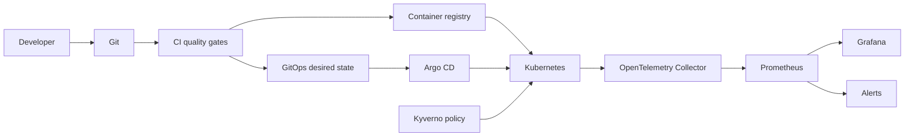

# Arsitektur

## Keputusan desain

- **Local-first:** lab dasar tidak memerlukan akun cloud atau biaya.
- **Satu workload:** perubahan pada contract aplikasi terlihat dampaknya pada seluruh delivery chain.
- **Dependency minimum:** demo API dan automation CLI hanya menggunakan Node.js standard library.
- **Declarative operations:** manifest, dashboard, alert, dan policy tersimpan di Git.
- **Secure defaults:** non-root, read-only filesystem, dropped capabilities, limited permissions, dan immutable delivery artifacts.
- **Failure is a feature:** fault injection dan runbook menjadi bagian dari acceptance criteria.

## Batasan

Lab tidak menggantikan desain produksi. Ia belum mencakup managed database, multi-region, disaster recovery penuh, enterprise identity, secret manager, registry retention, atau biaya cloud. Tambahkan satu kemampuan pada satu waktu dan dokumentasikan threat model serta blast radius-nya.
